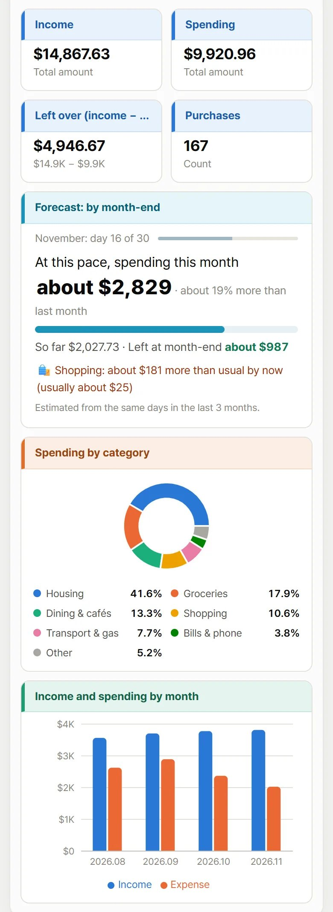
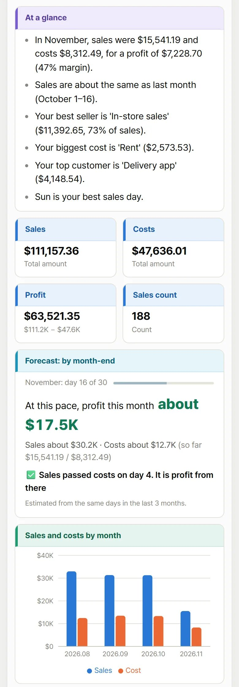

**Short version:** I'm looking for the **first 50 testers** for **Ganeum**, a budget and shop-ledger app I built myself. Use it for **2 weeks and send feedback twice**, and you'll get a **code for 3 months of the Shop Ledger free** at launch. Apply by **December 31** by emailing your name, phone type and email address to **info@thoysinc.com**. You can already try the app at [app.thoysinc.com](https://app.thoysinc.com).

## Why I built it

With a budget, writing things down is the easy part. Making sense of them is the chore. Even after you log everything, seeing where the money went this month means building another spreadsheet. So most of us keep it up for a month or two and stop.

I work in IT here in the US, and I've built reports at work. I used that experience to make an app where entry is three fields and the reports take care of themselves. It's called **Ganeum** (가늠), a Korean word for sizing up how things stand.

## For personal use: a household budget

Just enter spending or income, the amount and the item. A single line like "lunch 14.50 yesterday" works too. Your income and spending this month, money left over, spending by category and the monthly trend are all put together for you.

There's also a **forecast**. It looks at the same days in the last three months and tells you roughly where your spending will land this month. It also points out categories where you're spending more than usual.

*A sample household budget report. All numbers are made up.*

You can view amounts in dollars and won side by side, which helps families with money moving between the US and Korea.

## For a small business: a shop ledger

If you run a small shop or business in the US, just enter sales and costs. The report shows profit and margin, sales by weekday, sales by customer and your best sellers. At the top you get a plain-sentence summary like "profit this month is X, sales are down Y% from last month."

*A sample shop ledger report, using data for a made-up small restaurant.*

You can snap receipts with your phone and attach them to each entry. At year-end, it bundles your ledger and receipt photos into one ZIP file laid out like a US Schedule C, ready to send to your accountant.

To be clear, Ganeum is not a tax or accounting service, and I'm not a tax preparer or a CPA. The tax-line suggestions and the ZIP are just a summary of what you entered, so please confirm filing and deduction decisions with a licensed tax professional.

This post contains an affiliate link. If you buy through it, the blog may earn a commission at no extra cost to you.

Even if you photograph your receipts, it's nice to keep the paper originals in one place. An <a href="https://www.amazon.com/s?k=accordion+file+organizer&tag=thoysinc-20" target="_blank" rel="sponsored noopener">accordion file organizer</a> makes it easy to sort them by month.

## Your records stay on your device

No sign-up, no ads, no bank connection. What you enter is never sent to a Ganeum server. It stays on your own phone or PC. Just make a backup file when you switch devices.

## Pricing

The household budget is free. Importing card or bank spreadsheets (Personal Plus) is a one-time $4.99. The Shop Ledger is $7.99 a month or $69.99 a year after a 15-day free trial. These are US prices, and you pay and cancel through the app store you installed from.

## Tester details

I'm looking for people who will actually use it before launch and tell me honestly what they think. Shop owners are especially welcome, but using it only as a household budget is fine too.

- **Spots:** first 50 people, sign-ups close December 31, 2026
- **What you do:** install the app from your invite and keep it for at least 14 days, and send feedback twice (once in week 1 and once in week 2; short is fine)
- **What you get:** every feature free during the test, and a code for 3 months of the Shop Ledger free at launch once you meet the conditions
- **How to apply:** email your name, phone type (iPhone or Android) and email address to info@thoysinc.com. For iPhone, use your Apple Account email; for Android, use the Gmail address signed in to the Play Store, so I can send the invite.

I won't ask for star ratings or reviews, and I won't ask you to send screenshots or records. Full terms are at [app.thoysinc.com](https://app.thoysinc.com/en/#testers).

It hasn't officially launched yet, so there will be rough edges. Please try it and tell me what bugs you. That helps more than anything.

*There's a Korean version of this post on my life blog: [가계부 쓰다 말다 하셨다면: 직접 만든 앱 가늠, 테스터 50분을 모집해요](https://life.thoysinc.com/ganeum-app-testers/).*
